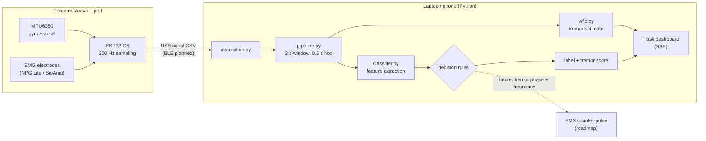
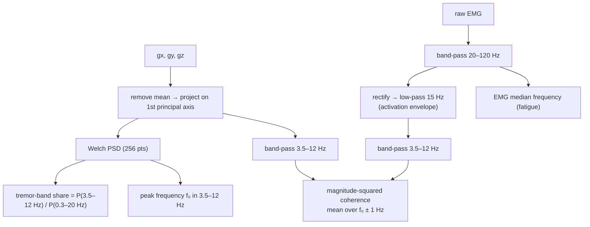
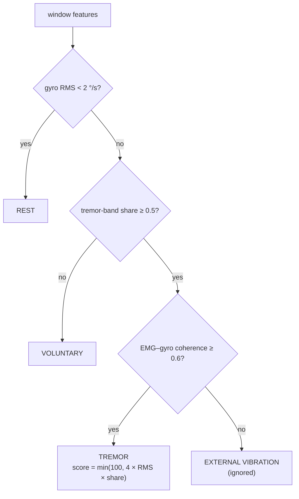

# NILAI — Technical Design Document

Version 0.1 · Team Nilai (HSC|TN|00325) · October 2026

## 1. Goal

Detect involuntary hand tremor in real time from a forearm wearable and separate it from intentional movement and from external vibration, so that a person with tremor (essential tremor, Parkinson's, age-related) can see an objective daily tremor score, and so that a later suppression stage knows *when* and *at what frequency/phase* to act.

### Requirements

| ID | Requirement | How it is met |
|---|---|---|
| R1 | Classify each 3 s window as rest / voluntary / tremor / external vibration | `classifier.py` |
| R2 | Latency ≤ 1 s from motion to label | 0.5 s hop, ~10 ms compute per window on a laptop |
| R3 | No false tremor from vehicle/tool vibration | EMG–gyro coherence gate |
| R4 | Work regardless of how the pod is rotated on the arm | PCA projection of 3-axis gyro |
| R5 | Run with no hardware for demos/tests | synthetic + CSV sources |
| R6 | Data stays on the user's device | local processing, no cloud dependency |

## 2. System architecture



### Components

| Module | Responsibility |
|---|---|
| `firmware/esp32_imu_stream` | Configure MPU6050 (±500 °/s, 44 Hz DLPF), calibrate gyro bias, stream `t_ms,emg,gx,gy,gz` at 250 Hz |
| `nilai/acquisition.py` | Uniform sample iterator over serial, BLE, CSV or synthetic sources |
| `nilai/pipeline.py` | Ring buffers; emits a window every hop |
| `nilai/dsp.py` | Filtering and spectral primitives |
| `nilai/classifier.py` | Features + decision |
| `nilai/wflc.py` | Adaptive tremor estimator for the "steady twin" |
| `nilai/dashboard` | Live UI over Server-Sent Events; JSON API |

## 3. Signal processing



**Why PCA instead of vector magnitude?** The magnitude √(gx²+gy²+gz²) rectifies an oscillation and doubles its apparent frequency (6 Hz → 12 Hz). Projecting onto the dominant axis keeps sign and frequency and is independent of pod orientation.

**Why coherence at f₀ instead of the band maximum?** With 3 s windows, the maximum coherence across many bins is biased upward by chance. Averaging around the gyro's own peak frequency halves the false-positive rate from external vibration.

## 4. Decision logic



Thresholds were chosen from a sweep over 10 seeds × 4 tremor frequencies on synthetic data:

| Window | Tremor coherence (p1) | Vibration coherence (p99) | False tremor at 0.6 |
|---|---|---|---|
| 2 s | 0.75 | 0.79 | 2.9 % |
| **3 s** | **0.77** | **0.49** | **0.0 %** |

All thresholds are environment variables so they can be re-tuned on real recordings.

## 5. WFLC tremor estimator

The Weighted-frequency Fourier Linear Combiner (Riviere et al., 1998) models the band-passed motion as a sinusoid with adaptive frequency ω₀ and adaptive Fourier weights:

```
x_k = [sin(r·φ_k), cos(r·φ_k)]  r = 1..M,   φ_k = Σ ω₀
y_k = w_kᵀ x_k
ε_k = s_k − y_k
ω₀ ← ω₀ + 2 μ₀ ε_k Σ r (w_r x_{M+r} − w_{M+r} x_r)
w  ← w + 2 μ ε_k x_k
```

The dashboard subtracts `y` from the motion signal to show the *steady twin* — what the movement looks like with tremor removed. The tracked ω₀ and phase are exactly what a future suppression stage needs to time a counter-stimulus. Test: on a 7 Hz tremor riding on a 0.5 Hz reach, WFLC converges to 7.0 ± 0.5 Hz and removes > 70 % of the tremor-band RMS.

## 6. Data formats

**Serial / CSV:** header `t,emg,gx,gy,gz`; one row per sample at 250 Hz. `t` in seconds (CSV) or ms (raw serial), `emg` ADC counts centred on zero, `gx..gz` in deg/s.

**Dashboard event (`/stream`, `/api/latest`):**

```json
{
  "label": "tremor", "tremor_score": 80.0, "tremor_peak_hz": 5.86,
  "tremor_band_ratio": 0.99, "emg_gyro_coherence": 0.84,
  "gyro_rms": 20.0, "emg_rms": 41.2, "emg_median_hz": 64.0,
  "t": 23.99, "emg": [...], "gyro": [...], "steady": [...]
}
```

## 7. Testing

`pytest -q` runs 25 tests covering the DSP primitives, WFLC convergence and every classifier scenario (see README). The sample CSVs in `data/sample/` are also verified to classify as their file name.

## 8. Safety, privacy and limits

- Current build **senses and classifies only**; no stimulation hardware is driven by this code.
- Planned EMS stage: current-limited biphasic driver, clinician-set limits, user-triggered only, physical stop button.
- All processing is local; no personal data leaves the device. Any future sharing with caregivers will be consent-based (DPDP Act 2023).
- Thresholds are validated on synthetic and bench data; clinical validation with people with tremor is the next milestone.

## 9. Roadmap

1. Record labelled sessions with volunteers (rest, tasks, vibration) and re-tune thresholds; add a learned classifier on the same features.
2. On-device inference on the ESP32-C6 and BLE streaming to a mobile app.
3. Daily tremor-score history and personalised exercise plans.
4. EMS suppression module with the safety measures above, after clinical guidance.
